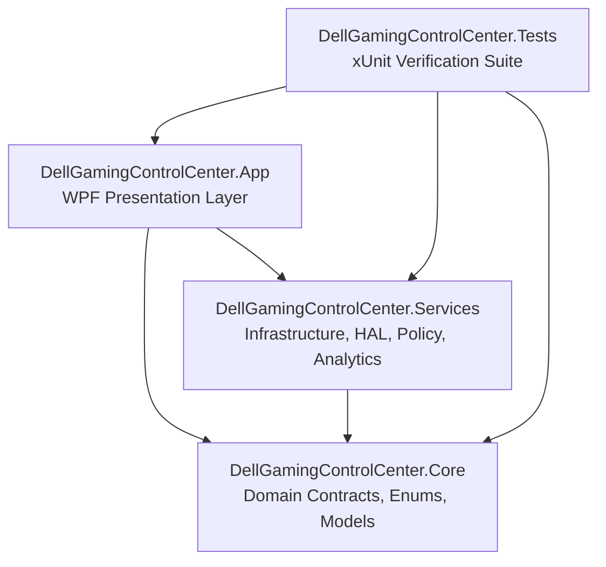
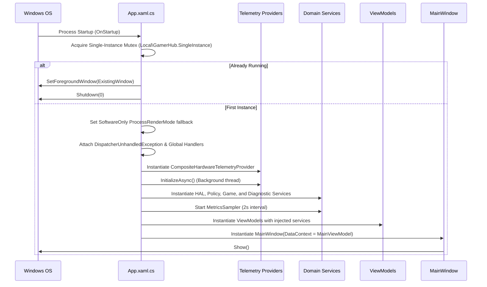
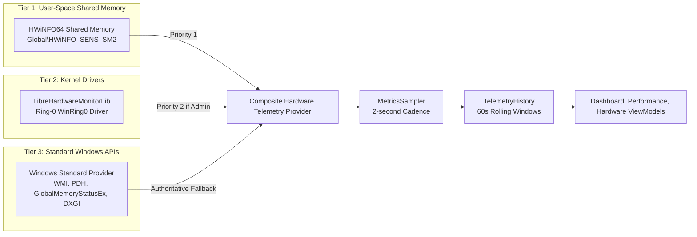
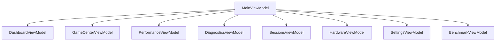

# GamerHub Architecture Guide

This document describes the runtime architecture, composition root, dependency injection flow, MVVM boundaries, lifecycle management, and persistence mechanisms of GamerHub.

---

## 1. Architectural Overview & Boundaries

GamerHub is structured into three clean application layers plus an isolated test suite:



### Layer Responsibilities

1. **`DellGamingControlCenter.Core`**:
   - Zero dependencies on outer layers or GUI frameworks.
   - Contains domain interfaces (`IHardwareTelemetryProvider`, `IGameSessionManager`, `IPerformanceModeService`, `IConfigurationService`).
   - Defines domain models (`GameProfile`, `DiagnosticSnapshot`, `AppConfig`, `SessionReport`).
   - Houses common enumerations (`PerformanceMode`, `GpuPreference`, `CapabilityStatus`, `LogSeverity`).

2. **`DellGamingControlCenter.Services`**:
   - Implements HAL (Hardware Abstraction Layer), operating system interop, and business rules.
   - Houses telemetry providers (`CompositeHardwareTelemetryProvider`, `HWiNFOSharedMemoryProvider`, `WindowsStandardTelemetryProvider`).
   - Implements security-conscious policy evaluators (`AuthorizationService`, `ControlAuditLogger`, `PolicyEvaluator`, `WindowsPowerPlanService`).
   - Implements game lifecycle managers (`GameSessionManager`, `GameLauncher`, `SessionMonitoringService`, `BenchmarkService`).

3. **`DellGamingControlCenter.App`**:
   - WPF application assembly (`WinExe`).
   - Composition root (`App.xaml.cs`) configuring singleton service instances.
   - MVVM presentation layer: XAML views, view models, value converters, custom controls, and resource dictionaries.
   - 3D CPU die visualization via WPF Viewport3D and procedural mesh generation.

---

## 2. Application Startup & Composition Root

Application initialization is governed strictly by `App.xaml.cs`:



### Key Startup Guarantees

- **Single-Instance Mutex:** `Local\GamerHub.SingleInstance` prevents multiple processes from concurrent file writes to `%LocalAppData%\DellGamingControlCenter\config.json`.
- **Global Error Handling:**
  - `DispatcherUnhandledException`: Unwraps `XamlParseException` down to inner root causes, logs full stack traces via `LoggingService`, presents informative dialogs, and marks handled to keep the application stable.
  - `AppDomain.CurrentDomain.UnhandledException`: Logs fatal non-UI exceptions to `activity_log.json`.
  - `TaskScheduler.UnobservedTaskException`: Marks background task faults observed to prevent runtime termination.
- **Render Fallback:** Software rendering fallback (`RenderMode.SoftwareOnly`) ensures offscreen capture tools (such as UI testing harnesses) render the visual tree correctly without GPU driver stalls.

---

## 3. Hardware Telemetry Pipeline

GamerHub uses an authoritative three-tier telemetry pipeline orchestrated by `CompositeHardwareTelemetryProvider`:



### Telemetry Sampling Rules

1. **Hardware Honesty:** If Tier 1 and Tier 2 are inactive or lack sensor support, CPU junction core temperatures, live core clocks, and fan tachometers report `double.NaN` / `Unavailable`. They are NEVER fabricated.
2. **ACPI Motherboard Temperature:** Identified cleanly as `25.0°C (ACPI)` and never conflated with CPU core junction temperature.
3. **Rolling Histories:** `TelemetryHistory` maintains bounded buffers of 30 snapshots (60 seconds at 2-second sampling cadence). Null samples indicate unavailable hardware readings and are plotted as gaps rather than 0%.

---

## 4. MVVM Responsibilities & UI Flow

- **Views:** Declarative XAML user controls and windows. Views bind directly to properties on ViewModels. Views contain zero business logic.
- **ViewModels:** Inherit from `BaseViewModel` (implementing `INotifyPropertyChanged`). Expose observable collections, state properties, and `ICommand` implementations (`RelayCommand`, `AsyncRelayCommand`).
- **Navigation:** Controlled by `MainViewModel.CurrentView` switching user controls in the main content host without reloading windows.



---

## 5. Persistence & Local Data

All configuration, game profiles, and logs are persisted to the user's roaming-isolated profile directory:

```text
%LocalAppData%\DellGamingControlCenter/
├── config.json          # Application configuration, game profiles, user preferences
└── activity_log.json    # Structured audit events, warnings, and diagnostic traces
```

- **Persistence Implementation:** `ConfigurationService` serializes and deserializes `AppConfig` with atomic write replacement (`File.WriteAllText`).
- **Upgrade Safety:** Uninstallation and binary updates do not delete `%LocalAppData%\DellGamingControlCenter`, preserving user-configured libraries and profiles.
