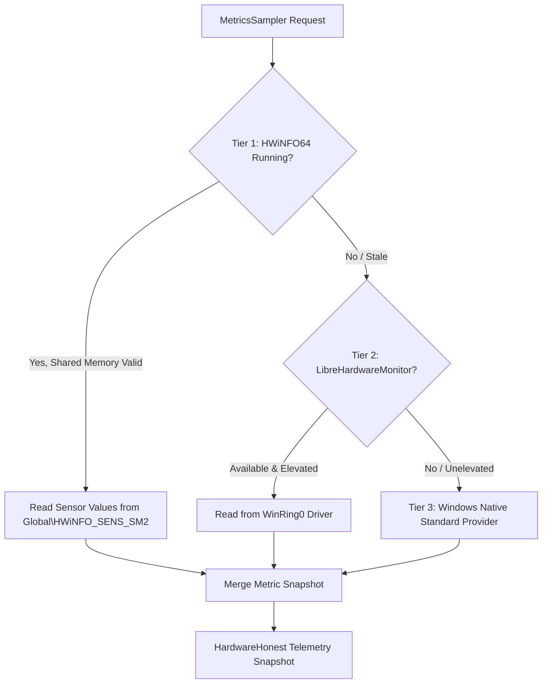

# GamerHub Hardware Capabilities & Telemetry Contract

This document provides the authoritative hardware capabilities matrix, telemetry contracts, data source mappings, and security guarantees for GamerHub.

---

## 1. Hardware Support Matrix

*Evaluated specifically for Windows x64 gaming platforms (including Dell Inspiron 3576 / Intel Core i3-7020U / Intel HD 620 / AMD Radeon 520).*

| Metric / Control | Support Level | Primary Source | Fallback Source | Behavior When Unavailable |
| :--- | :--- | :--- | :--- | :--- |
| **CPU Utilization (%)** | **Supported** | HWiNFO Shared Memory | Performance Counter / Win32 | Displays live percentage from Windows OS API. |
| **CPU Live Clocks (MHz)** | **Conditional** | HWiNFO Shared Memory | None | Displays `Unavailable`. Never estimates from base clock. |
| **CPU Junction Temp (°C)** | **Conditional** | HWiNFO Shared Memory | LibreHardwareMonitor | Displays `Unavailable`. Never uses ACPI zone as CPU temp. |
| **Motherboard Temp (°C)** | **Supported** | ACPI Thermal Zone (`MSAcpi_ThermalZoneTemperature`) | None | Explicitly labeled as `25.0°C (ACPI)`. |
| **RAM Total / Used (MB)** | **Supported** | Win32 `GlobalMemoryStatusEx` | WMI `Win32_OperatingSystem` | Displays exact physical RAM allocation. |
| **GPU Utilization (%)** | **Supported** | DXGI Adapter Query / PDH | HWiNFO Shared Memory | Displays live 3D engine utilization for discrete/integrated GPUs. |
| **GPU Temperature (°C)** | **Conditional** | HWiNFO Shared Memory | None | Displays `Unavailable` for AMD Radeon 520 without vendor SDK. |
| **Fan Speed (RPM)** | **Conditional** | HWiNFO Shared Memory (Dell EC sensor) | None | Displays `Unavailable` or `Unsupported`. |
| **Battery Level / Status** | **Supported** | Win32 `GetSystemPowerStatus` | WMI `Win32_Battery` | Real-time AC/battery status and charge percentage. |
| **Storage Active Time (%)** | **Supported** | Performance Counter `PhysicalDisk` | None | Real-time disk queue / active time. |
| **FPS / Frame Times** | **Unavailable** | PresentMon / Overlay Hook | None | Displays `Unavailable`. GamerHub does not inject game hooks. |
| **Windows Power Plans** | **Supported** | Win32 `PowerSetActiveScheme` | `powercfg.exe` | Switches active scheme (Gaming / Balanced / Quiet). |
| **GPU Preference** | **Supported** | Windows Registry (`DirectX\UserGpuPreferences`) | None | Per-game GPU binding honored by Windows DWM. |
| **CPU Undervolting / Fan Control** | **Unsupported** | None | None | Explicitly blocked and labeled unavailable. No Ring-0 EC writes. |

---

## 2. Telemetry Architecture & Fallback Cascade

GamerHub uses a strict 3-tier cascade (`CompositeHardwareTelemetryProvider`):

### Telemetry Tier Guarantees

### Tier 1 — HWiNFO64 Shared Memory
- **Protocol:** Reads structured memory mapped section `Global\HWiNFO_SENS_SM2` with mutex synchronization `Global\HWiNFO_SM2_MUTEX`.
- **Integrity Check:** Validates signature (`HWiS`), header size, version, and poll count. Detects stale data if timestamp has not advanced for >10 seconds.
- **Sensor Resolution:** Maps sensors by reading type (`HWiNFOReadingType.Temp`, `Clock`, `Fan`, `Power`) and sensor index.

### Tier 2 — LibreHardwareMonitorLib
- **Scope:** Used only if HWiNFO is not active and the process has sufficient driver access.
- **Safety:** Never auto-elevates or silently drops unsigned kernel drivers.

### Tier 3 — Windows Standard Telemetry
- **Scope:** Standard user APIs requiring zero driver access:
  - CPU usage: `System.Diagnostics.PerformanceCounter("Processor Information", "% Processor Utility", "_Total")`.
  - RAM: `GlobalMemoryStatusEx`.
  - Battery: `GetSystemPowerStatus`.
  - Storage: `PerformanceCounter("PhysicalDisk", "% Disk Time", "_Total")`.
  - Motherboard thermals: WMI ACPI thermal zone.

---

## 3. Strict Hardware Honesty Principles

1. **Zero Fake Readings:** Temperatures, clock speeds, and fan RPM are NEVER simulated, interpolated, or randomized.
2. **Thermal Disambiguation:** Motherboard ACPI temperatures (`25.0°C (ACPI)`) are strictly differentiated from CPU package/core junction thermals (`Tdie` / `Tctl`).
3. **Privilege Integrity:** GamerHub runs as an unelevated standard desktop application. It does not drop kernel drivers, write to model-specific registers (MSR), or issue raw I/O port writes to Embedded Controllers (EC).
4. **Graceful Degradation:** When low-level sensors are unreachable, the UI gracefully labels metrics as `Unavailable` and renders charts with gaps rather than false zero values.
